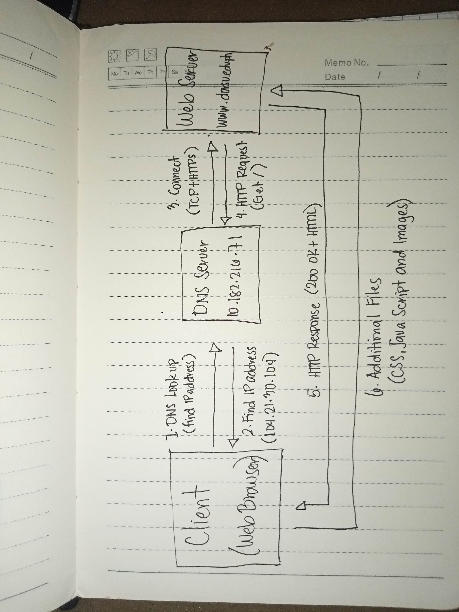

nslookup www.edu.ph

Server: UnKnown
Address: 10.182.216.71

Non- authoritative answer:
Name: www.dorsu.edu.ph
Addresses: 2606:4700:3036::6815:1e68
2606:4700:3036::ac43:acbf
172.67.172.191
104.21.30.104

The Journey of a URL
1. The URL

I used the URL https://www.dorsu.edu.ph/. The protocol is https://, which tells the browser to communicate with the website securely. The domain name is www.dorsu.edu.ph, which identifies the website I want to visit. The / represents the homepage of the website.

2. DNS Lookup

Computers communicate with each other using IP addresses. Since people usually enter website names instead of IP addresses, the browser needs DNS to find the IP addresses connected to the domain name. In my lookup, the DNS server address was 10.182.216.71. It returned two IPv4 addresses and two IPv6 addresses for www.dorsu.edu.ph.

3. Connection

After finding an IP address, the browser connects to the website's server. Since the website uses HTTPS, the browser also establishes a secure connection using TLS encryption. This helps protect the information exchanged between the browser and the website.

4. HTTP Request

After establishing the connection, the browser sends an HTTP request to the server to ask for the homepage. It uses the GET method because it wants to receive the webpage. The request identifies the website using its domain name.

5. HTTP Response

After receiving the request, the server sends an HTTP response to the browser. The response includes a status code that tells whether the request was successful. For example, 200 OK means the request was successful. The response also contains headers and website content, such as HTML.

6. Rendering

After receiving the website files, the browser reads and processes the HTML, CSS, and JavaScript. HTML provides the structure, CSS controls the appearance, and JavaScript adds interactive features. The browser then arranges and displays the webpage on the screen. It may also request additional files, such as images, fonts, and other resources.

Diagram

Questions

1. Which computer is the client and which is the server?

The client is my computer using a web browser to access the DOrSU website. It sends a request to get the webpage. The server is the computer that hosts the website and responds by sending the requested website information.

2. What does the user see if the DNS lookup fails?

If the DNS lookup fails, the browser cannot find the IP address connected to the website's domain name. Because of this, it cannot connect to the website using that domain. The user may see an error message such as "This site can't be reached" or a DNS-related error.

3. What is the difference between 200, 301, and 404?

200 OK – This means the request was successful and the server returned the requested webpage. For example, when the DOrSU homepage loads successfully.

301 Moved Permanently – This means the webpage has permanently moved to another URL. For example, when an old website address redirects visitors to its new address.

404 Not Found – This means the server cannot find the requested page. For example, when someone opens a deleted page or an incorrect website link.